

<picture><source media="(max-width: 700px)" srcset="./assets/header-m.svg" /></picture>

  

<picture><source media="(max-width: 700px)" srcset="./assets/me-m.svg" /></picture>

  

<a href="https://m360travel.com"><picture><source media="(max-width: 700px)" srcset="./assets/masr360-m.svg" /></picture></a>

  

<picture><source media="(max-width: 700px)" srcset="./assets/stack-m.svg" /></picture>

  

<a href="https://github.com/Abdelrahman-Mohamed-program/Tavelsta"><picture><source media="(max-width: 700px)" srcset="./assets/r-tavelsta-m.svg" /></picture></a>
 
<a href="https://github.com/Abdelrahman-Mohamed-program/Amaniango"><picture><source media="(max-width: 700px)" srcset="./assets/r-mango-m.svg" /></picture></a>
 
<a href="https://github.com/Abdelrahman-Mohamed-program/Backend-self-learning"><picture><source media="(max-width: 700px)" srcset="./assets/r-notes-m.svg" /></picture></a>
 
<a href="https://github.com/Abdelrahman-Mohamed-program/Portfolio"><picture><source media="(max-width: 700px)" srcset="./assets/r-portfolio-m.svg" /></picture></a>

  

<picture><source media="(max-width: 700px)" srcset="./assets/journey-m.svg" /></picture>

  

<picture>
  <source media="(prefers-color-scheme: dark)" srcset="https://raw.githubusercontent.com/Abdelrahman-Mohamed-program/Abdelrahman-Mohamed-program/output/snake-dark.svg" />
  <source media="(prefers-color-scheme: light)" srcset="https://raw.githubusercontent.com/Abdelrahman-Mohamed-program/Abdelrahman-Mohamed-program/output/snake-light.svg" />
  
</picture>

  

<picture><source media="(max-width: 700px)" srcset="./assets/footer-m.svg" /></picture>

<a href="https://abdelrahman.tech"><picture><source media="(max-width: 700px)" srcset="./assets/b-portfolio-m.svg" /></picture></a>
<a href="https://linkedin.com/in/abdelarahman-mohamed"><picture><source media="(max-width: 700px)" srcset="./assets/b-linkedin-m.svg" /></picture></a>
<a href="mailto:abdelarahman2022@gmail.com"><picture><source media="(max-width: 700px)" srcset="./assets/b-email-m.svg" /></picture></a>

