

 


  


<a href="https://about.m360travel.com"></a>

  


  


<a href="https://github.com/Abdelrahman-Mohamed-program/Masr360-Backend"></a>
<a href="https://github.com/Abdelrahman-Mohamed-program/m360landing-backend"></a>
<a href="https://github.com/Abdelrahman-Mohamed-program/Tavelsta"></a>
<a href="https://github.com/Abdelrahman-Mohamed-program/Amaniango"></a>
<a href="https://github.com/Abdelrahman-Mohamed-program/Backend-self-learning"></a>
<a href="https://github.com/Abdelrahman-Mohamed-program/Portfolio"></a>

  


  


<picture>
  
</picture>

<picture>
  <source media="(prefers-color-scheme: dark)" srcset="https://raw.githubusercontent.com/Abdelrahman-Mohamed-program/Abdelrahman-Mohamed-program/output/snake-dark.svg" />
  <source media="(prefers-color-scheme: light)" srcset="https://raw.githubusercontent.com/Abdelrahman-Mohamed-program/Abdelrahman-Mohamed-program/output/snake-light.svg" />
  
</picture>

  

<a href="https://leetcode.com/u/abdelarahman-leetcoder"></a>

